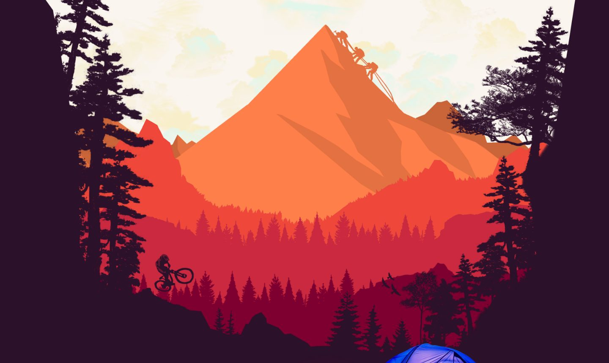
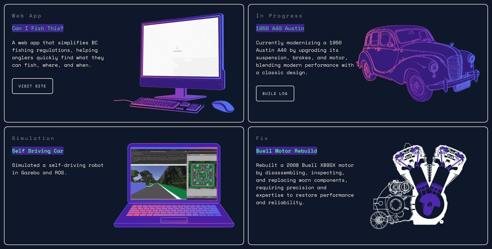

# portfolio-website

Dawson Horvath's portfolio, [dawsonhorvath.com](https://dawsonhorvath.com): a parallax
landscape, project cards whose line art fills with colour as you hover, a contact form, the
1950 Austin A40 build log, and the live resume (served by the separate
[resume-generator](https://github.com/HorvathDawson/resume-generator) app). React + TypeScript +
Vite, deployed to Cloudflare (Workers static assets, see `wrangler.jsonc`).





## Development

```sh
npm install
npm run dev      # local dev server
npm run build    # type-check and build to dist/
npm run lint
npm run preview  # build, then serve dist/ with wrangler
```

## Contact form

The form posts to `/api/contact` on the site Worker. It needs Email Routing on
`dawsonhorvath.com` with the recipient verified as a destination, and three
Worker secrets (Workers & Pages → personal-website → Settings → Variables and
Secrets, type *Secret*):

- `CONTACT_FROM`: sending address on the domain (e.g. `contact@dawsonhorvath.com`)
- `CONTACT_TO`: the verified destination address
- `TURNSTILE_SECRET`: the Turnstile widget's secret key

For local testing copy `.dev.vars.example` to `.dev.vars` and run `npm run preview`.
After changing `wrangler.jsonc`, regenerate the Worker types with
`npx wrangler types worker/worker-configuration.d.ts`.

## Layout

- `src/App.tsx`: home page (parallax header, about, project cards, contact form)
- `src/data/projects.tsx`: the project cards (copy, links, visual, scroll animation), rendered by `ProjectCard`.
  Cards marked `draft: true` are spares waiting for a project: hidden on the live page, shown in
  development and with `?drafts` in the address
- `src/data/content.ts`: about text, header layers, contact links
- `src/data/site.ts`: domain, titles and descriptions used for `<head>` metadata
- `src/components/visuals/`: the artwork shown inside each card, built from `ArtLayer`/`LayeredArt`
- `src/blog/`: the A40 build log and roadmap (`/a40`, `/a40/roadmap`), loaded as a separate chunk
- `content/a40/`: build log posts in Markdown
- `src/utils/scrollFrame.ts`: shared, rAF-batched scroll subscription used by all scroll effects
- `src/utils/reducedMotion.ts`: the one `prefers-reduced-motion` check (CSS side at the end of `App.css`)
- `vite.plugins.ts`: home-page header preloads, `<head>` metadata, `sitemap.xml`
- `worker/index.ts`: the site Worker; handles `POST /api/contact` (Turnstile check, then
  email via Cloudflare Email Routing) and forwards `/resume-generator/*` to the
  `resume-generator` Worker over a service binding. Other static files never reach it.
- `public/assets/`: images; home page artwork is WebP

## Assets

Home page images are WebP. Card artwork is capped at 1600px on its long edge,
which is enough for 2x/3x screens at the size the cards render. Header layers
keep their full 3000x2000 resolution; phones get 1500w copies via `srcset`.

Derived images are generated, so re-run the scripts after changing a source:

```sh
python3 scripts/make-header-images.py  # 1500w header layers, blurred placeholder, og/home.jpg
python3 scripts/make-stills.py         # *-still.webp frames for reduced motion
```

### Card artwork

Each card shows white line art at rest and fades to a version filled with the site's
pink→purple→blue gradient on hover (`ArtLayer` layers `background` and `foreground`; screens and
glows are `splash` layers). The gradient versions come from white line art:

```sh
python3 scripts/make_svg.py art.svg            # art_background.svg (white) + art_foreground.svg (gradient)
python3 scripts/trace_outline.py outline.webp  # trace white line art (PNG/WebP) to SVG, then run make_svg.py
python3 scripts/trace_outline.py --photo photo.webp --crop x0,y0,x1,y1  # or a cut-out photo, as a sketch
python3 scripts/make_device_art.py             # the spare cards' computer, tablet and TV drawings
```

The A40 card is traced from its outline drawing this way. The tracing scripts need
`pip install potracer pillow numpy svgpathtools shapely opencv-python-headless`.

To give a spare card a project: fill in its text and link in `src/data/projects.tsx`, pass the
project's screen recording(s) to `<DeviceDisplay screens={[...]} />` (desktop first) and remove
`draft: true`.

